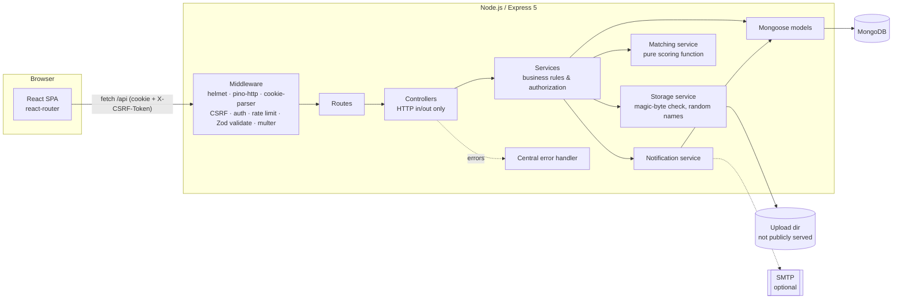

# Lost & Found

A full-stack web application for reporting lost and found items, claiming found items, and getting
**explainable match suggestions** between lost and found reports.

Built with **Node.js 24, Express 5, MongoDB/Mongoose, React 19 + Vite**. Authentication uses a JWT in an
HTTP-only cookie with CSRF protection.

---

## Features

**Users**
- Register, log in, log out (bcrypt-hashed passwords, generic login errors, rate-limited login/register)
- Create, edit, delete and resolve lost or found reports, with an optional photo
- Browse reports with full-text search, filters (type, category, status, location, date range), sorting and pagination
- Dashboard: my reports (with pending-claim counts), my claims, claims to review

**Claims workflow**
- Claim a *found* item by describing details only the owner would know
- Only the report owner can accept or reject. Accepting resolves the report and auto-rejects the other pending claims
- You can't claim your own report. Duplicate pending claims are blocked by a database index
- Claim messages are private (claimant, report owner, admins). Email addresses are shared **only after acceptance**
- Claimants can withdraw pending claims

**Matching**
- A deterministic scoring service compares lost vs. found reports using category, title/description keywords, date proximity and location words
- Every suggestion has a 0–100 score and human-readable reasons. It's always labelled a *potential* match
- Suggestions are visible only to the report owner. Strong matches trigger notifications

**Notifications**
- In-app notifications for new claims, claim decisions, potential matches and moderation actions
- Optional email via SMTP. The app works fully without email credentials

**Administration**
- Overview stats, list/search users, deactivate/reactivate users
- Moderation queue for flagged reports (users can flag a report once), with remove (soft delete, with reason), restore and dismiss flags

**Engineering**
- Layered backend: routes → controllers → services → models, plus middleware, validators and config
- Consistent JSON responses and a centralized error handler
- Zod validation of every body, query and params object (strict: unknown fields are rejected)
- Indexes for search, listings, dashboards and the moderation queue
- Structured logging (pino) with redaction of cookies, tokens and passwords
- Graceful shutdown (HTTP server, then MongoDB)
- OpenAPI 3.1 spec with Swagger UI at `/api/docs`
- 79 backend integration tests (Vitest + Supertest) against a separate `_test` database

---

## Architecture



**Request lifecycle example (`POST /api/items/:id/claims`):**
`csrfProtection` → `requireAuth` (loads the user from the DB) → `validate` (Zod) → `claim.controller.create`
→ `claim.service.createClaim` (rules: found item, not own, open, no duplicate) → `Claim.create` → notify owner
→ `sendSuccess` → `{ success: true, data: {...} }`.

### Folder structure

```
lost-and-found/
├── client/                     React + Vite frontend
│   ├── src/api/client.js       fetch wrapper: CSRF header, error mapping
│   ├── src/context/            AuthContext (session, unread count)
│   ├── src/hooks/useAsync.js   loading/error/data state for API calls
│   ├── src/components/         Layout, ProtectedRoute, ClaimCard, UI primitives
│   └── src/pages/              Home, Item detail/form/claims, Dashboard, Notifications, Admin, Auth
├── server/
│   ├── src/
│   │   ├── app.js              Express app factory (no network/DB, so it's testable)
│   │   ├── server.js           Starts the app: DB connect, listen, graceful shutdown
│   │   ├── config/             env validation (Zod), DB connection, logger
│   │   ├── routes/             URL → middleware chain → controller
│   │   ├── controllers/        HTTP translation only
│   │   ├── services/           business logic (auth, items, claims, matching, notifications, storage, email, admin)
│   │   ├── models/             User, Item, Claim, Notification (+ indexes)
│   │   ├── middleware/         auth, csrf, validate, upload, rateLimit, errorHandler
│   │   ├── validators/         Zod schemas
│   │   ├── utils/              AppError, response helpers, serializers (DTOs), escapeRegex
│   │   ├── docs/               openapi.yaml + Swagger UI router
│   │   └── scripts/seed.js     fictional demo data
│   ├── storage/uploads/        local image storage (git-ignored)
│   └── tests/                  Vitest + Supertest integration tests
├── Dockerfile, docker-compose.yml
├── .env.example
└── package.json                npm workspaces + root scripts
```

### Key design decisions

| Decision | Why |
|---|---|
| JWT in an **HTTP-only, SameSite=Lax** cookie (`Secure` in production) | JavaScript can't read the token, so XSS can't steal it. Lax blocks cookies on cross-site POSTs |
| **Double-submit CSRF token** (`csrf_token` cookie echoed in the `X-CSRF-Token` header) | Cookies are sent automatically, so cookie auth needs CSRF protection. Another site can't read our cookie to forge the header |
| JWT contains **only the user id**. The role is loaded from the DB on every request | A changed role or deactivated account takes effect immediately. A forged role is impossible |
| **Single origin** (Vite proxy in dev, Express serves `client/dist` in prod) | No CORS configuration. Cookies and CSRF just work |
| **Strict Zod schemas** | Fields like `owner` or `role` in a request are rejected, never trusted |
| **Explicit DTO serializers** | Raw documents are never returned, which prevents leaking hashes, emails or claim messages |
| **Conditional atomic updates instead of transactions** for accepting claims | Transactions need a replica set. `findOneAndUpdate({ status: 'pending' })` makes each step safe under concurrency, with a compensating rollback |
| **Partial unique index** `{item, claimant}` where `status = 'pending'` | The DB itself guarantees "one pending claim per user per item", even under race conditions |
| **Uploads**: memory → magic-byte check → random filename → private folder → served via a route with `nosniff` | The client's MIME type isn't trusted. No path traversal. No executable content served as HTML |
| **Soft delete** for moderation | Admins can restore mistakes, and owners see why their report was removed |

---

## Prerequisites

- **Node.js 22+** (developed with Node 24 LTS) and npm 10+
- **MongoDB 7+** running locally on `mongodb://127.0.0.1:27017`, or Docker (see below)

## Setup

```bash
git clone <your-repo-url> lost-and-found
cd lost-and-found
npm install                      # installs server + client (npm workspaces)
cp .env.example .env             # then set JWT_SECRET (see below)
node -e "console.log(require('crypto').randomBytes(48).toString('hex'))"   # paste as JWT_SECRET
npm run seed                     # optional: fictional demo data
npm run dev                      # API on :4000, web app on http://localhost:5173
```

**Demo accounts** (created by `npm run seed`, all fictional, password `Password123`):

| Email | Role |
|---|---|
| admin@example.com | admin |
| alice@example.com | user (has a lost wallet and a pending claim) |
| ben@example.com | user (has a found wallet with a claim to review, and lost keys with a match) |
| chloe@example.com | user |

`npm run seed` refuses to touch a non-empty database. Use `npm run seed -- --reset` to replace the data. It
also refuses to run when `NODE_ENV=production`.

### Docker Compose

```bash
cp .env.example .env    # set JWT_SECRET
docker compose up --build
# open http://localhost:4000  (the API serves the built client)
docker compose exec app node server/src/scripts/seed.js   # optional demo data
```

The container runs with `NODE_ENV=production`, so cookies have the `Secure` flag. Browsers accept those on
`http://localhost`, but on any other host you need HTTPS.

## Environment variables

| Variable | Default | Description |
|---|---|---|
| `NODE_ENV` | `development` | `development`, `test` or `production` |
| `PORT` | `4000` | API port |
| `MONGODB_URI` | `mongodb://127.0.0.1:27017/lost_found_dev` | Main database |
| `MONGODB_URI_TEST` | `mongodb://127.0.0.1:27017/lost_found_test` | Test database (name **must** end in `_test`) |
| `JWT_SECRET` | — (**required**, ≥ 32 chars) | Signs session tokens |
| `SESSION_TTL_HOURS` | `24` | Session/cookie lifetime |
| `BCRYPT_ROUNDS` | `12` | Password hashing cost |
| `LOGIN_RATE_LIMIT` | `10` | Login/register attempts per IP per 15 min |
| `TRUST_PROXY` | `false` | Set `true` behind a reverse proxy so rate limiting sees real client IPs |
| `APP_URL` | `http://localhost:5173` | Public URL used in email links |
| `UPLOAD_DIR` | `server/storage/uploads` | Image storage directory |
| `MAX_UPLOAD_MB` | `5` | Max image size |
| `LOG_LEVEL` | `info` | pino log level |
| `SMTP_HOST`, `SMTP_PORT`, `SMTP_SECURE`, `SMTP_USER`, `SMTP_PASS`, `EMAIL_FROM` | empty | Optional email. Leave `SMTP_HOST` empty to disable |

The server validates all variables at startup and exits with a clear message if something is wrong.

## Scripts

| Command (repo root) | What it does |
|---|---|
| `npm run dev` | API (`node --watch`) + Vite dev server together |
| `npm test` | Backend test suite |
| `npm run build` | Build the client into `client/dist` |
| `npm start` | Start the API (serves `client/dist` when `NODE_ENV=production`) |
| `npm run seed` | Seed fictional demo data |

## API documentation

- Swagger UI: **http://localhost:4000/api/docs**
- Raw spec: `GET /api/docs/openapi.json` (source: `server/src/docs/openapi.yaml`)

Response format:

```jsonc
// success
{ "success": true, "data": { ... }, "meta": { "page": 1, "limit": 12, "total": 42, "totalPages": 4 } }
// error
{ "success": false, "error": { "code": "VALIDATION_ERROR", "message": "Request validation failed",
  "details": [{ "location": "body", "path": "title", "message": "Title must be at least 3 characters" }] } }
```

Main endpoints:

| Method | Path | Auth |
|---|---|---|
| GET | `/api/auth/csrf` | – |
| POST | `/api/auth/register`, `/api/auth/login`, `/api/auth/logout` | – / – / user |
| GET | `/api/auth/me` | user |
| GET | `/api/items` (search, filters, pagination), `/api/items/:id` | public |
| GET | `/api/items/mine` | user |
| POST / PATCH / DELETE | `/api/items`, `/api/items/:id` | owner (DELETE: owner or admin) |
| POST | `/api/items/:id/resolve`, `/api/items/:id/flag` | owner / other users |
| GET | `/api/items/:id/matches` | owner or admin |
| GET / POST | `/api/items/:id/claims` | owner or admin / other users |
| GET | `/api/claims/mine`, `/api/claims/received`, `/api/claims/:id` | user (participants only) |
| POST | `/api/claims/:id/decision`, `/api/claims/:id/withdraw` | report owner / claimant |
| GET / POST | `/api/notifications`, `/unread-count`, `/:id/read`, `/read-all` | user |
| * | `/api/admin/...` (stats, users, items, remove, restore, dismiss-flags) | admin |

## Testing

```bash
npm test                 # needs MongoDB at MONGODB_URI_TEST (default mongodb://127.0.0.1:27017/lost_found_test)
```

- Tests run against a **separate database**. `tests/setup.js` refuses to run unless the database name ends in
  `_test`, then clears only that database between tests
- Test files run sequentially (shared database). Uploads go to `server/tests/.uploads`, which is deleted afterwards
- Coverage areas: registration/login, unauthorized and CSRF-less requests, rate limiting, ownership checks,
  item creation/editing, invalid input, file upload validation, path traversal, NoSQL operator injection, search
  and pagination, the full claim workflow (duplicates, own report, decisions, contact disclosure), matching
  (unit + API), notifications, admin permissions and moderation, OpenAPI docs

There are no automated frontend tests. The UI was checked manually and with a one-off browser script during
development (see *Known limitations*).

## Production image storage

`server/src/services/storage.service.js` is the only module that touches files. For production, keep its
interface (`saveImage`, `resolveImagePath`, `deleteImage`) and back it with object storage:

1. Create a **private** S3 / Azure Blob / GCS bucket.
2. In `saveImage`, keep the magic-byte check and random key, then `PutObject` with the detected `Content-Type`.
3. Replace the `/api/uploads/:key` route with a redirect to a **short-lived signed URL** (or put a CDN in front).
4. Add the bucket name, region and credentials as environment variables. Never commit them.

Local uploads are git-ignored because they may contain personal information.

## Known limitations

- **No transactions:** claim acceptance uses conditional updates with a compensating rollback. A process crash
  between steps could leave a claim accepted while the item is still open. With a MongoDB replica set, wrap
  `decideClaim` in `session.withTransaction()`.
- **Rate limiting** uses an in-memory store (per process). Multiple instances would need Redis.
- **Registration reveals whether an email exists** (409 on duplicates). That's a common UX trade-off. A stricter
  design would send a verification email instead. There is also **no email verification or password reset**.
- **JWTs can't be revoked individually.** Logout clears the cookie, and deactivation is enforced because the user is
  re-loaded on each request, but a copied token stays valid until it expires (24 h by default).
- **Matching** is keyword-based (English stopwords, naive plural stemming). It doesn't understand synonyms
  ("purse" vs "wallet") or geography.
- **Search** uses MongoDB's text index, which matches whole (stemmed) words, not partial words or typos.
- **Notifications** are polled every 30 s, not pushed (no WebSockets).
- **Images** aren't resized or stripped of EXIF metadata (which can contain GPS location). Use `sharp` for both in
  production.
- **No frontend automated tests**, and Docker Compose was written but not run in the development environment.
